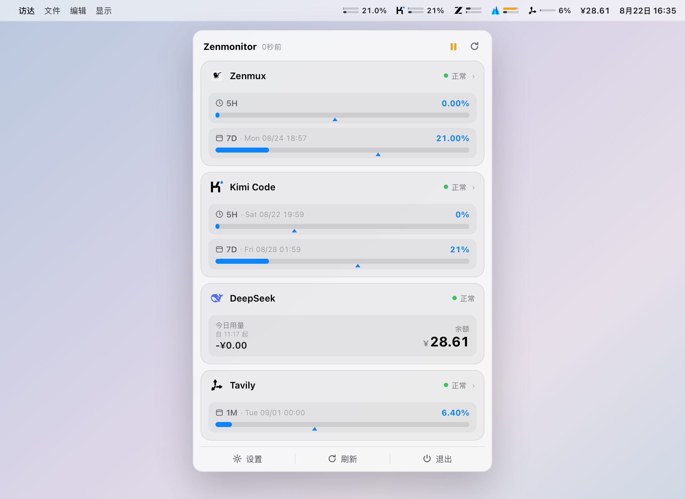

# Zenmonitor

[](https://opensource.org/licenses/MIT)
[](https://www.apple.com/macos/)
[](https://swift.org/)
[](https://github.com/jianxing-chen/zenmonitor/releases)
[](https://jianxing-chen.github.io/zenmonitor/)
[](#赞助支持)

**macOS 菜单栏多源 AI 用量监控工具**——把各家 AI 服务的配额、余额与消耗实时放进菜单栏，一眼掌握，不占 Dock、不占窗口。

🌐 **官方网页**：[jianxing-chen.github.io/zenmonitor](https://jianxing-chen.github.io/zenmonitor/)（产品介绍与下载入口）

## ✨ 功能特性

- **八源监控**：配额型与余额型统一抽象，架构可随时扩展新源（见下方[支持的监控源](#-支持的监控源)）
- **每源独立状态栏项**：各源可在设置中独立开关菜单栏项——进度条、余额文本或品牌徽章三种形态；全部关闭时保留 App Logo 入口，永不失联
- **下拉面板实时展示**：配额窗口进度条 + 重置时间 + 颜色三档预警（蓝→橙→红），面板打开期间数据到达即时更新
- **统一自动刷新 + 每源独立倍率**：全局刷新间隔（30s~5m）为统一调度来源，每张源卡片可另选 ×1/×2/×4/×10 倍率（实际周期 = 全局间隔 × 倍率），精细控制各源请求频率
- **区块拖拽排序**：设置面板直接拖动源卡片调整下拉面板区块顺序，即时生效
- **多显示器外观自适应**：状态栏图标采用系统模板着色，深浅混合多屏下每块屏幕的菜单栏自动适配
- **7 天用量预测阴影**：进度条叠加半透明阴影，预警「上游窗口用满后本窗口将达到的位置」
- **时间进度标记**：每条进度条下方的三角形标记指示当前窗口的时间进度——用量低于标记即消耗慢于时间流逝，消耗节奏是否健康一眼即知
- **本地优先**：API Key 与全部配置仅保存在本机（UserDefaults），不上传任何服务器；纯菜单栏运行，空闲内存 ~20MB

## 🧩 支持的监控源

| 源 | 类型 | 监控内容 | 特性 |
|---|---|---|---|
| **Zenmux** | 配额型 | 5H / 7D 双窗口配额、月度上限、汇率 | 双域名切换（zenmux.ai / zenmux.dev）、区块详情可折叠、暂停/继续 |
| **DeepSeek** | 余额型 | 账户余额、赠金/充值 | 本地整点采样差值推算**今日用量**（充值自动重置基线） |
| **Kimi Code** | 配额型 | 5H 滚动频控 + 7D 周额度 | 整数粒度诚实展示（<1% 标注）、状态四档对应真实频控 |
| **智谱 GLM** | 配额型 | 5H + 周限额 | **国内版（bigmodel.cn）/ 国际版（z.ai）切换**、业务错误透传 |
| **火山方舟** | 配额型 | Agent Plan AFP 配额（5H/7D/1M） | AK/SK **V4 签名**认证（CryptoKit 实现） |
| **Tavily** | 配额型 | 月度 Credits 配额 + 端点消耗明细 | 客户端节流适配端点限流（10 次/10 分钟）、区块默认折叠 |
| **OpenCode Go** | 配额型 | 5H/7D/1M 三窗口配额 + 精确重置时间 | 官方 /usage 端点、标准 Bearer（与推理同 Key）、业务错误透传 |
| **StepFun Step Plan** | 配额型 | 月度 Credit 月池（已用 / 剩余 / 总量）+ 重置时间 | **国内站 / 海外站切换**、时间进度标记按月池重置日自动推算、数据完整性提示 |

## 📸 截图



<!-- 更多真实截图位（后续补充）：


-->

> 图示数据均为示例。

## 🚀 安装

### 方式一：下载预编译版本（推荐）

1. 从 [Releases](https://github.com/jianxing-chen/zenmonitor/releases) 下载最新版 `Zenmonitor-vX.X.X.zip`
2. 解压并将 `Zenmonitor.app` 拖入「应用程序」(`/Applications`)
3. 终端执行以下命令移除 quarantine 标记（Ad Hoc 签名，避免 Gatekeeper 拦截）：
   ```bash
   xattr -d com.apple.quarantine /Applications/Zenmonitor.app
   ```
4. 打开 Zenmonitor 即可使用；可在 系统设置 → 通用 → 登录项 中设为开机自启（应用内设置亦提供开关）

### 方式二：自行编译

```bash
git clone https://github.com/jianxing-chen/zenmonitor.git
cd zenmonitor
open Zenmonitor.xcodeproj   # Cmd+R 运行
```

## ⚙️ 配置

1. 点击菜单栏图标 → **设置**
2. 在各源卡片填入对应凭据（首次保存自动开启该源状态栏显示）：

   | 源 | 凭据 | 获取入口 |
   |---|---|---|
   | Zenmux | Management API Key | [zenmux.ai 控制台](https://zenmux.ai/platform/management) |
   | DeepSeek | API Key（sk-...） | [platform.deepseek.com](https://platform.deepseek.com/api_keys) |
   | Kimi Code | API Key（sk-kimi-...） | [Kimi Code 控制台](https://www.kimi.com/code/console) |
   | 智谱 GLM | Coding Plan API Key（国内/国际版不通用） | [bigmodel.cn](https://bigmodel.cn/usercenter/proj-mgmt/apikeys) / [z.ai](https://z.ai/manage-apikey/apikey-list) |
   | 火山方舟 | AccessKey + SecretKey（IAM，非推理 Key） | [火山引擎 IAM](https://console.volcengine.com/iam/keymanage) |
   | Tavily | API Key（tvly-...） | [app.tavily.com](https://app.tavily.com/home) |
   | OpenCode Go | API Key（Go 订阅，与推理同 Key） | [opencode.ai/auth](https://opencode.ai/auth) |
   | StepFun Step Plan | Step Plan API Key（国内/海外站不通用） | [platform.stepfun.com](https://platform.stepfun.com/step-plan) / [platform.stepfun.ai](https://platform.stepfun.ai/step-plan) |

3. 每张卡片可独立开关「在菜单栏显示」、选择刷新倍率，并拖动调整区块顺序。

## 🏗️ 架构

```
MonitoredSource 协议（sourceID / snapshot / refresh(force:) / onStateChange）
        ↓
SourceSnapshot 统一快照（.quota 配额型 / .balance 余额型）
        ↓
SourceRegistry 注册中心（八源注册 / 全局定时器 / 每源倍率调度）
        ↓
状态栏：每源独立 NSStatusItem + 模板图自绘（多屏外观自适应）
下拉面板：SourceQuotaSection / SourceBalanceSection 按用户排序渲染
```

**添加新源只需四步**：

1. 新建 `Services/YourAPIService.swift`，实现 `MonitoredSource` 协议
2. 在 `SourceRegistry.init()` 中注册
3. 在 `SettingsView` 新增 `YourSourceCard` 并在 `sourceCard(for:)` 加 case
4. （可选）添加品牌 Logo imageset 与状态栏徽章分支

状态栏、下拉面板、自动刷新、拖拽排序全部自动适配。

## 📋 系统要求与技术栈

- **系统**：macOS 15.7+（Sequoia），Apple Silicon / Intel 通用
- **技术栈**：Swift 5.9+，SwiftUI（设置面板/下拉面板）+ AppKit（NSStatusItem 状态栏、窗口管理）混合架构；CryptoKit（火山 V4 签名）；零第三方依赖

## 📊 资源占用

- 内存：空闲 ~20MB，打开设置面板 ~40MB（Logo 资源均 ≤512px，防巨图解码驻留）
- CPU：空闲 < 0.1%，无轮询时 ≈ 0%
- 网络：全局定时器按「间隔 × 每源倍率」调度；Tavily 内置节流适配端点限流；DeepSeek 另有整点余额采样

## 🤝 贡献

欢迎提交 Issue 与 Pull Request！新源接入请参考上方[架构](#️-架构)四步法。

## 赞助支持

如果 Zenmonitor 帮到了你，欢迎请作者喝杯蜜雪冰城，支撑这个开源项目持续维护：

| 微信赞赏 | 支付宝赞赏 |
|:---:|:---:|
|  |  |

## 📄 License 与致谢

[MIT](LICENSE) © jianxing-chen

致谢：各平台用量端点的字段形态参考了开源社区的实证实现——[cc-switch](https://github.com/farion1231/cc-switch)（智谱/火山）、[token-monitor](https://github.com/Javis603/token-monitor)（Kimi）、[glm-usage](https://github.com/showlotus/glm-usage)（智谱）；品牌图形版权归各平台所有，仅用于本应用内的源标识展示。
